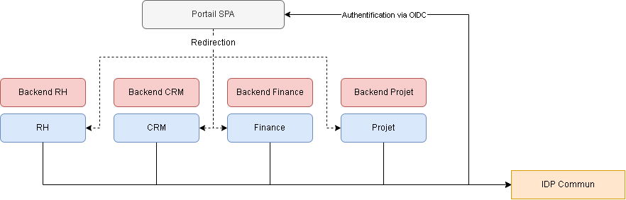

# Architecture d'un portail unifié

## Rappel du besoin et choix réalisés

L'entreprise dispose de 4 applications web existantes indépendantes (RH, CRM, Finance, Projet). Nous n'avons pas d'informations sur les technologies utilisées pour ces applications, on part du principe qu'elles peuvent être developpées avec 4 technologies différentes.

Le besoin identifié est le suivant : produire un portail d'accès unifié à ces 4 applications, sans avoir a redévelopper les applications dans leurs ensemble. Le portail doit également afficher uniquement les applications auxquelles l'utilisateur connecté est habilité à accéder. La gestion des habilitations est centralisée auprès du fournisseur d'identité, tandis que chaque application reste responsable du contrôle effectif des accès.

Les applications restent accessible par leur url classiques, sans passer par le portail de centralisation

## Perimètre de la solution 

On part du principe que c'est la seule fonctionnalité du dashboard, il ne s'occupe d'aucune consolidation de données provenant des autres application, ni d'aucune règle métier. Il n'est pas de la responsabilité du portail non plus de contrôler l'accès aux applications et aux données de celles-ci

Le portail prend donc en charge les éléments suivant :

- Authentification de l'utilisateur
- Gestion du droit d'accès aux applications
- Affichage de ces applications disponible
- Redirection vers les application sans réauthentification visible pour l'utilisateur
- Déconnexion centralisée : la déconnexion sur le portail ou sur une application entraine la déconnexion sur tous les autres services

## Solution proposée

On préconise un portail sous la forme d'une SPA et une gestion de l'authentification via un IDP commun entre tous les sites existants. Chacune des applications garde sa manière de fonctionner actuelle et indépendante (backend non unifié) mais doit se rattacher à la même solution d'IDP afin de garantir un flux authentifié agréable pour l'utilisateur. Le portail va alors simplement rediriger l'utilisateur vers le site qu'il souhaite consulter. 

Voici un schéma simple de la solution proposée. Chaque choix et éléments seront détaillés ensuite

## Stack technique

La stack technique sera faite des composants suivants :

| Composant | Responsabilité |
|---|---|
| **Portail** | Afficher les applications visibles selon les habilitations et ouvrir leurs URL. |
| **IDP** | Authentifier, gérer la session SSO, exposer les habilitations d'accès aux applications. |
| **Applications métiers** | Contrôler l'accès réel et leurs permissions internes (ex. créer un devis ou consulter la paie). |
| **Hébergement web** | Distribuer les fichiers statiques du portail en HTTPS. |

Le tableau suivant montre chaque couche des composants décrits précédemment avec les technologies préconisées :

| Couche | Préconisation | Justification |
|---|---|---|
| **Frontend** | **TypeScript** | Typage statique, lisibilité et meilleure maintenabilité.|
| **Framework** | **Vue 3** ou **React** | Un framework web moderne, maintenu et connu de l'équipe suffit pour l'interface légère. Le choix final dépend des compétences et standards existants. |
| **Backend du portail** | **Aucun backend dédié** | Pas de logique métier ni d'agrégation de données justifiant un serveur supplémentaire. |
| **Catalogue** | Configuration versionnée (applications, URL par environnement, habilitations requises) | Adapté à quatre applications. L'ajout d'une application passe par une modification contrôlée et un redéploiement. |
| **Identité** | **Keycloak** ou **IDP d'entreprise existant** | Réutilisation du SI si possible pour éviter un deuxième référentiel d'identité non nécessaire. |
| **Hébergement** | Plateforme existante adaptée, sinon **Azure Static Web Apps** | Hébergement statique managé sans serveur applicatif. |

### Frontend, framework et catalogue

Pour le choix du frontend du portail, on préconise de realiser une SPA. La simplicité des fonctionnalités du portail ne nécessite pas de complexifier la structure en rajoutant un backend, ou d'aller vers une solution plus complexs qui peuvent exister comme un micro-frontend.

On choisit typescript plutot que javascript simple, qui permet plus de rigueur et de robustesse de par le typage statique. 

Le choix du framework dépend principalement des compétences de l'équipe et des standards déjà en place. Vue 3 est proposé comme référence, mais React pourrait répondre au même besoin sans impact majeur sur l'architecture retenue.

Comme il n'y a pas de backend dédié au front, le catalogue d'application disponible devra être maintenu "en dur" dans l'application front. Cela comporte le désavantage de devoir redéployer l'application si un élément de la configuration venait à changer (nouveau site, changement d'URL). C'est une limite assumée puisque ce cas ne devrait pas arriver de manière regulière.

### Identité

L'énoncé ne décrit pas si l'entreprise dispose déjà d'un service d'authentification unifié qui permettrait de gérer une session centrale multi application. Si c'est le cas, il faut réutiliser l'existant.

Sinon, on choisit d'utiliser Keycloak, qui permet de gérer simplement l'authentification avec le parcours suivant :

1. l'utilisateur ouvre le portail, qui le redirige vers l'IDP.
2. L'IDP authentifie l'utilisateur, le portail termine son flux de connexion et récupère les informations de session.
3. Le portail affiche les liens autorisés (par exemple RH et CRM).
4. l'utilisateur clique sur CRM : le portail ne lui transmet pas ses propres tokens.
5. Le CRM démarre **son propre flux de connexion** auprès de l'IDP. La session SSO existante évite de redemander les identifiants, le CRM établit ensuite sa propre session.

Pour permettre le SSO, chaque application sera enregistrée comme un client distinct auprès du même Realm Keycloak. Elles pourront ainsi bénéficier d'une session SSO commune, tout en conservant leurs propres tokens et sessions applicatives.

La communication entre l'IDP et les clients devrait se faire via le protocole moderne OIDC, qui permet un échange normé entre les deux parties. Cela permet aussi de pouvoir éventuellement changer d'IDP plus simplement.

#### Gestion des droits et permissions

On sépare volontairement les notions de droits d'accès aux applications et permissions liées aux applications.

- **Habilitations globales** : l'accès à RH, CRM, Finance ou Projets est défini dans l'IDP ou l'annuaire raccordé (ex. groupes `APP_RH`, `APP_CRM`). Ces groupes pilotent la visibilité des liens et doivent être également contrôlés par les applications une fois intégrées. Ces habilitations seront transmises au portail par l'IDP, par exemple via un claim personnalisé dans l'ID Token. Le portail les utilisera pour filtrer les applications affichées à l'utilisateur.
- **Permissions métier** : une fois dans le CRM, les droits de consultation, création ou administration restent gérés par le CRM. Aucun transfert général de ces permissions vers l'IDP ne doit être fait.

#### Déconnexion globale et durée des sessions

Il existe trois leviers pour effectuer une déconnexion avec un IDP supportant OIDC : 

- Back-channel logout : a privilégier mais demande à ce que le client ait un backend avec un endpoint lui permettant de traiter la requête
- Front-channel logout : son fonctionnement n'est pas garanti suivant le fonctionnement du navigateur du client
- Access Tokens courts : solution sûre mais la session reste valide tant que l'access token n'est pas révoqué.

### Hébergement 

**Hébergement** Priorité à une solution statique déjà exploitée par l'entreprise, pour éviter de multiplier les technologies. Sinon, **Azure Static Web Apps** constitue une solution de référence concrète (HTTPS, certificats gérés, domaines personnalisés et intégration CI/CD). 

**CORS :** La navigation entre le portail et les applications métiers s'effectue via des liens classiques et ne nécessite aucune configuration CORS particulière. En revanche, les appels HTTP effectués depuis le JavaScript d'une application vers un IDP situé sur une autre origine (notamment pour récupérer les tokens) nécessitent une configuration CORS adaptée côté IDP.

**Déploiement** Pipeline GitHub Actions / Gitlab CI (ou outil CI/CD existant) : installation des dépendances, vérifications TypeScript, lint, tests ciblés, build, publication de l'artefact sur l'environnement de recette puis production.
